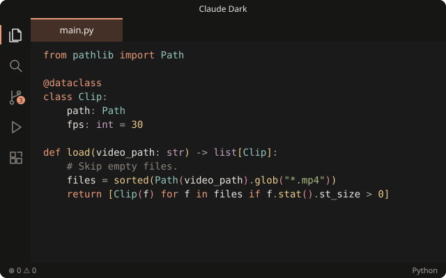
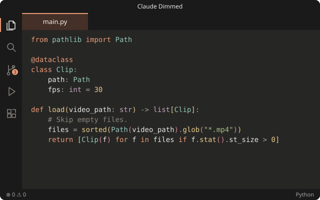

# Claude Theme

Theme VS Code tông màu kiểu Claude: nền than ấm, chữ kem, màu nhấn cam `#d97757`. Extension kèm theo style cùng tông cho [Markdown Preview Enhanced](https://marketplace.visualstudio.com/items?itemName=shd101wyy.markdown-preview-enhanced) (MPE).

| Claude Dark | Claude Dimmed |
| --- | --- |
|  |  |

## Tính năng

- **Hai theme tối** cho giao diện, terminal (16 màu ANSI) và màu cú pháp, kể cả semantic token (Python/Pylance). Hai theme dùng cùng màu chữ và màu cú pháp, chỉ khác độ tối của nền:
  - **Claude Dark**: nền tối, editor `#1a1a1a`.
  - **Claude Dimmed**: nền xám ấm như claude.ai, editor `#262624`.

  Comment không in nghiêng: dấu `|` in nghiêng của JetBrains Mono trông giống `/`.
- **Style cho MPE** (`mpe/style.less`):
  - Font Source Sans 3 / Source Serif 4 / JetBrains Mono, tải từ Google Fonts. Khi offline thì dùng font dự phòng có đủ dấu tiếng Việt.
  - Cột chữ căn giữa.
  - Code block cùng màu với editor.
- **Lệnh `Claude Theme: Install Markdown Preview Enhanced Style`**, làm 3 việc:
  - Ghi `style.less` vào thư mục cấu hình global của MPE.
  - Đặt `markdown-preview-enhanced.previewTheme` và `codeBlockTheme` thành `vscode.css`.
  - Cho file `.md` mặc định mở bằng MPE.

  Nếu đã có sẵn một `style.less` không phải của extension này, file đó được giữ lại thành `style.less.bak-<thời điểm>`.
- **Khi khởi động:** nếu `style.less` do extension này cài trước đó thì tự cập nhật lên bản mới. Nếu chưa cài thì hỏi một lần cho mỗi phiên bản.

## Cài đặt

1. Tải file `.vsix` từ trang Releases, hoặc tự build theo hướng dẫn bên dưới.
2. Trong VS Code: Command Palette, chạy **Extensions: Install from VSIX...**, chọn file `.vsix`.
3. Chọn theme: `Ctrl+K Ctrl+T`, chọn **Claude Dark** hoặc **Claude Dimmed**.
4. Nếu dùng MPE: bấm **Install** khi được hỏi, hoặc chạy lệnh **Claude Theme: Install Markdown Preview Enhanced Style**.

Extension chạy cùng phía với MPE (`extensionKind: workspace`). Trên WSL / Remote, hãy cài khi đang kết nối remote để style được ghi vào đúng thư mục mà MPE đọc.

## Build

Cần Node 22 trở lên. Không cần `npm install`.

```bash
node scripts/build-vsix.js       # tạo dist/claude-theme-<version>.vsix
node scripts/render-preview.js   # vẽ lại images/*.svg từ file theme
```

Script tự đóng gói `.vsix` (zip + manifest) mà không dùng `@vscode/vsce`. Nếu muốn đưa lên Marketplace thì dùng `vsce package` / `vsce publish` như bình thường.

## Ghi chú kỹ thuật

- **Thư mục cấu hình MPE** được tìm giống cách MPE làm, theo thứ tự:
  1. Setting `markdown-preview-enhanced.configPath`.
  2. Windows: `~/.crossnote`.
  3. `$XDG_CONFIG_HOME/crossnote`.
  4. `~/.local/state/crossnote`.
- **Căn giữa:** MPE đặt `margin: 0` cho khung preview bằng một selector mạnh hơn selector của style này. Vì vậy cột chữ được căn giữa bằng padding: `max(24px, calc((100% - 800px) / 2))`. Biểu thức này được bọc trong `~"..."` để LESS không tự tính `max()` lúc biên dịch.
- **Font:** không dùng Georgia làm font dự phòng vì thiếu các chữ tiếng Việt như ặ, ữ, ộ.
- **Opacity:** theme preview `vscode.css` của MPE làm mờ blockquote, h6 và chữ gạch ngang bằng `opacity`. Style này đặt lại `opacity: 1`.

## Ghi công

Bảng màu và cách trình bày preview được chuyển từ extension [Claude Style Markdown Preview](https://github.com/ibank/claude-style-markdown-preview) (MIT).
